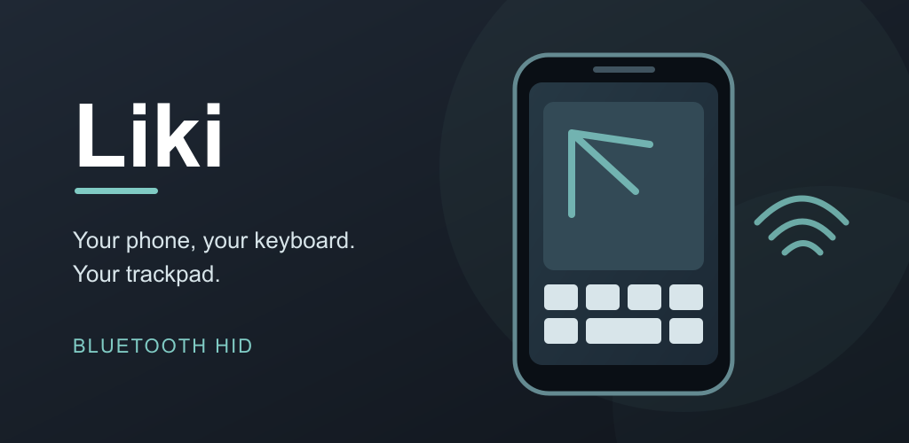

# Liki



スマホをBluetoothキーボード兼マウス・トラックパッドとして使うReact Native / Expoアプリです。AndroidはBluetooth HID Device、iOSはCoreBluetoothのBLE HID（HID over GATT）を使用します。PCへの常駐ソフトは不要です。

この実験ブランチではAndroidの送信もBLE HID over GATTに切り替えています。Androidの動作条件・接続手順・未検証項目は[BLE HID送信の実験手順](docs/android-ble-hid.md)を参照してください。以下のAndroid HID Deviceに関する説明はmain版のものです。

## ダウンロード

[GitHub Releases](https://github.com/hringdrifi/liki/releases) でAndroid用の署名済みAPKと対応ソースを公開します。配布APKはJavaScriptを同梱しており、開発サーバーなしで起動できます。署名付きIPAは配布しません。iOSは各自のApple Developerアカウントと署名環境でビルドしてください。

v1.0.3から現在のExpo版へ移行しています。旧Android版・Flutter版の設定や保存レイアウトは引き継がず、初期設定から開始します。Expo版で保存した設定とレイアウトは次回起動時にも復元されます。

## 動作条件

### Android

- Android 9（API 28）以上で、端末が `BluetoothHidDevice` に対応し、OS側でBluetooth HID Deviceサービスが有効になっていること
- Bluetooth HIDホストとしてペアリングできるPC（Windows、macOS、Linuxなど）
- Androidはアプリが前面から外れるとHID登録を解除する場合があります。ホームからアプリへ戻ったとき、前回接続していたPCへの再接続を一度試みます。

AndroidのバージョンとBluetooth搭載の条件を満たしていても、HID Deviceサービスが提供されていない、または無効になっている端末では使えません。HID Deviceは端末をキーボード・マウスとして使う機能で、外付けキーボードを接続するHID Hostとは別です。

「HIDサービスを準備中…」のまま進まない場合は、端末側のHID Deviceサービスを利用できていない可能性があります。Fireタブレット（KFMAWI、Fire OSビルド `PS7331.4463N`）では、サービスに接続できず、ADBからの有効化もOSの権限で拒否されることを確認しています。通常の開発者オプションにはBluetooth HID Deviceサービスを有効にする設定はありません。

### iOS

- iOS 16.4以上、arm64。作成したIPAの最低OS設定でも確認しています。
- iPhone 8 / 8 Plus / X、iPhone SE第2世代以降などがOS条件上の対象です。iPhone 7以前とSE第1世代は対象外です。古い機種での実機動作は未検証です。[Appleの対応機種一覧](https://support.apple.com/en-ie/103267)
- iPhoneのBluetoothを有効にし、LikiのBluetoothアクセスとペアリングを許可します。接続先はBluetooth LEのHID over GATTに対応している必要があります。
- 独自のiOSネイティブモジュールを含む署名済みビルドが必要です。Expo Goは使用できません。Ad Hoc開発ビルドは端末登録が必要で、iOSで要求されたら開発者モードを有効にします。

iOS版のビルドと実機起動を確認しています。実際のペアリング・キー入力・マウス操作の動作範囲は、機種と接続先ごとの確認が必要です。

## Androidでの使い方

1. Android端末でアプリを起動し、Bluetooth接続とBluetooth公開の権限を許可します。
2. 接続画面で「ペアリング待機」を押します。
3. PCのBluetooth設定からスマホを探し、双方に表示されるペアリング要求を承認します。
4. 接続画面で「更新」を押してPCを選び、「選択したPCに接続」を押します。接続中は同じボタンからキャンセルできます。次回は前回接続したPCが初期選択されます。PC側から接続される場合もあります。
5. 接続後はキーボード画面に切り替わります。右端中央の細い印から左へスワイプすると、レイアウト選択・表示のリセット・設定・切断のメニューが開きます。

トラックパッドを使う場合は、右端メニューの「レイアウトを選択」から「標準トラックパッド」を選びます。

「キーボード・マウスを中継」では、スマホにBluetooth接続したZMK Studio対応キーボードから物理配置とキー割り当てを自動取得し、レイアウトを表示します。Studioロック中はキーボード側で解除して「再取得」を押してください。表示レイヤーは画面で選択します。キーボード側の割り当ては変更しません。この機能を使うにはAndroid・iOSともネイティブ部分の再ビルドが必要です。AndroidではBifrostの物理配置と4レイヤーの取得・表示を実機で確認しています。iOSでもBifrostの49キーの配置取得と文字キーの中継を実機で確認しています。iOSでBifrostのトラックボール入力が届かない問題は調査中です。

受信したキーは押している間だけ色が付きます。同じキーコードを出す複数のキーは同時に色付き、タップ・ホールドなどの物理的な押下位置や現在のレイヤーは確定できません。マクロなどHIDキーの対応を取得できないビヘイビアは色付け対象外です。取得はBluetooth経由に限り、候補が複数ある場合は1台だけ接続してください。Androidでは接続中の入力デバイス名とペアリング済みBluetooth名を照合するため、名前が一致しない機種は自動取得できません。

設定画面では、画面の向きを自動・縦向き・横向き・横向き（反対向き）から選べます。「全画面表示」をオンにすると、接続後の操作画面でシステムバーを隠します。画面端からのスワイプで一時表示できます。「画面を常にON」にするとLikiを開いている間は自動消灯しません。「タッチ時に振動」は初期状態ではオフで、オンにするとキーのタップとトラックパッドのクリック時に振動します。キーピッチは概算値を確認し、3.0〜24.0 mmの手動設定ができます。自動で画面に収めた場合もキーの大きさは向きを変えても維持され、メニューの「表示をリセット」を押すと現在の向きでキーボード全体が画面に収まる大きさへ戻ります。「KLE JSONファイルに従った表示」は初期状態でオンです。オンならレイヤーに関係なくKLEの文字を表示し、オフなら各レイヤーで有効なキー割り当て名を表示します。修飾キーの保持、ピンチ拡大縮小、トラックパッドのタップクリック・長押しドラッグ・2本指スクロールも個別に切り替えられます。ポインターの速度とスクロール速度は0.5〜3.0倍で調整でき、スクロール方向も反転できます。設定は端末内に保存されます。

トラックパッドの「カーソルの送信間隔」は即時（毎回送信）・16ms（送信多め）・32ms（標準）を選べます。初期値は32msです。ポインターの速度を変えずに、カーソルの引っ掛かりや応答の違いを比べられます。

## KLEキーボード

右端メニューの「レイアウトを選択」から、標準トラックパッド、標準キーボード（TKL）、ファイル読み込みを選べます。標準トラックパッドの下には、上段に元に戻す・切り取り・コピー・貼り付け、中段にやり直し（Ctrl+Shift+Z）・やり直し（Ctrl+Y）・全選択・保存、下段にミュート・音量下げ・音量上げ・Enterの12キーがあります。標準キーボード（TKL）にはF列、Print Screen・Scroll Lock・Pause、Insert/Delete群、独立した矢印キーがあります。新しい標準トラックパッドを使うには「レイアウトを選択」から選び直してください。標準レイアウトを選び直すと個別のキー割り当ては初期化されます。ファイル読み込みでは [Keyboard Layout Editor](https://www.keyboard-layout-editor.com/) の **Download JSON** で保存した `.json` を選びます。KLEの行、空白、キーの幅・高さ、色、回転とラベルを反映します。KLEの「Raw Data」欄からコピーした省略記法は厳密なJSONではないため、ファイルに保存するときは Download JSON を使ってください。

「レイアウトを選択」の「現在のレイアウトに名前を付けて保存」では、KLE JSON、全レイヤーのキー割り当て、表示倍率、ドラッグで移動した位置をまとめて保存できます。保存した名前を選ぶとその状態を復元します。同じ名前で保存すると上書きを確認します。「保存したレイアウトを削除」では名前付きのレイアウトだけを削除でき、標準レイアウトは削除できません。復元後に変更した内容を保存し直すには、もう一度名前を付けて保存してください。

通常画面でキーをタップするとHIDキーを送ります。Ctrl、Shift、Alt、Win/Cmdはタップすると次のキーまで保持されます。割り当てを変えるには右端メニューの「キー割り当てを編集」を選びます。設定モードでは上部のレイヤーボタンで編集先を選び、キーをタップして割り当てます。「保存」で変更を確定し、「キャンセル」で破棄します。ラベルから推測できないキーは枠が赤く表示され、設定モードで割り当てが必要です。レイアウトと保存した割り当ては端末内に保存されます。

画面左上の小さな表示で現在のレイヤー（L0〜L3）を確認できます。レイヤー0が通常の割り当てです。レイヤー1〜3では未設定のキーはレイヤー0を継承し、設定モードの「ベースを継承」で個別の割り当てを解除します。キーには「レイヤー1/2/3切り替え」（同じレイヤーでもう一度押すと0へ戻る）、「次のレイヤー」（0→1→2→3→0）、「次の1キーだけレイヤー1/2/3」、「押している間レイヤー1/2/3」（QMKの `MO` に相当）、または「レイヤー0へ戻る」を割り当てられます。レイヤー切り替えに使ったキーは、効果が続く間だけShiftと同じ色で表示されます。「押している間」は1本の指でキーを押さえ、もう1本の指で別のキーをタップします。指を離すと元のレイヤーに戻ります。次の1キーだけの切り替えは、通常のキーを入力すると元のレイヤーに戻り、修飾キーだけでは戻りません。レイヤーごとの割り当ては端末内に保存されます。

キー割り当ての1段目は、先頭の「文字・数字」「記号」「基本キー」に続いて「修飾キー付き」「メディアキー」などのカテゴリから選びます。「修飾キー付き」では `LSFT` などの修飾キー、続けて `A` などの通常キーを選ぶと `LSFT(A)` のように割り当てられます。「修飾キーを追加…」から `LSFT(LCTL(A))` のような組み合わせも作れます。左右の `LCTL`、`LSFT`、`LALT`、`LGUI`、`RCTL`、`RSFT`、`RALT`、`RGUI` に対応します。KLEラベルには `LSFT(KC_A)` のような式を書いて自動割り当てもできます。「メディアキー」には再生／一時停止、前後の曲、停止、音量上下、ミュートをまとめています。メディアキーはConsumer Control HIDレポートとして送ります。既にペアリングしたPCでメディアキーが認識されない場合は、PCと端末のペアリングを解除してから再ペアリングしてください。

2本指で拡大縮小、1本指ドラッグでキーボードを移動できます。設定で「ドラッグでキーボードを移動」をオフにすると、通常キーをドラッグしても表示位置は変わりません。「表示をリセット」で表示倍率と位置を戻します。横向きの画面ではフルサイズのレイアウトを操作しやすくなります。

KLEの `g: true`（Ghosted）に指定したキー領域は、キーボード画面内のトラックパッドになります。その領域では1本指移動、タップ、ダブルタップ後のドラッグ、長押しドラッグ、2本指タップで右クリック、2本指スクロール、ピンチズーム、3本指タップで中クリックを使えます。ピンチズームはPCへCtrl＋ホイールとして送るため、対応する画面で動作します。Ghosted領域から始めた操作はキーボード表示のパンやズームに使われません。`g: false` で後続キーを通常キーへ戻せます。

KLEはキーの表示・配置形式であり、HIDコードを直接指定しません。自動割り当ては一般的なUS配列のラベルに対応します。PC側の配列が異なると記号などの出力が変わります。日本語などのUnicode文字はHIDキーコードに一対一で対応しません。

接続できないときは、両機器のペアリングを解除してからアプリを開いた状態で再ペアリングしてください。端末メーカーがHID Deviceプロファイルを提供していない場合、このアプリでは利用できません。

## iOSでの使い方

1. 署名した開発ビルドをiPhoneへインストールし、Metroへ接続してLikiを開きます。
2. Bluetooth権限を許可し、必要に応じて「BLEペアリング待機」を押します。
3. PCのBluetooth設定から「Liki」を追加して、ペアリング要求を承認します。iOS側からペアリング済みPCの一覧取得・接続開始はできません。
4. 接続後はAndroid版と同じキーボード・トラックパッド画面を使います。右端中央から左へスワイプするとメニューが開きます。使用中はLikiを前面に置いてください。

iOSのBLE HID実装は [darwin-bt-remote](https://github.com/jqssun/darwin-bt-remote) を基にしています。署名用の資格情報・端末情報・IPAの配布リンクは公開しません。

## 開発とビルド

プロジェクトはリポジトリ直下に置き、画面と操作はTypeScript、Android HIDはKotlin、iOS BLE HIDはSwiftで実装しています。ネイティブモジュールは `modules/liki-hid/` にあります。

AndroidのローカルビルドにはNode.js 24、JDK 21、Android SDK Platform / Build-Tools 37、CMake 3.31.6を使用しています。

```powershell
npm ci
npm run lint
npm run typecheck
npm test
npx expo prebuild --platform android --no-install
$env:JAVA_HOME = 'C:\Program Files\Microsoft\jdk-21.0.12.101-hotspot'
$env:ANDROID_HOME = 'C:\Users\ito\AppData\Local\Android\Sdk'
cd android
.\gradlew.bat :app:assembleDebug
```

開発クライアントでの実行にはリポジトリ直下で `npm start` を使います。Expo Goは独自のHIDモジュールを含まないため利用できません。MacなしでのEASビルドの手順と現在の検証範囲は [Expo移植メモ](docs/expo-port.md) を参照してください。

WindowsからiOS開発ビルドを作る場合は、Expoへログインし、自分のApple Developerアカウントで署名と端末登録を設定したうえでEASを使います。

```powershell
npx --yes eas-cli@latest device:create
npx --yes eas-cli@latest build --platform ios --profile development
npm start -- --lan
```

端末登録のWebsite方式では、表示URLを対象iPhoneのSafariで開きます。ビルド後はインストールページをiPhoneで開いてインストールします。開発クライアントの起動時は、iPhoneとPCを同じネットワークに接続し、PCのWi-Fi側IPのMetroへ接続してください。キー・マウス入力そのものはBluetoothで送信します。ネイティブコードを変更した場合は再ビルドが必要です。

比較用のFlutter版は `codex/flutter-faithful-port`（`1987ee2`）にあります。実機へのインストール・起動・操作画面の表示まで確認済みです。

Android 12以降ではBluetooth接続・公開の実行時権限を要求します。探索権限や位置情報権限は不要です。

## ライセンス

本プロジェクトは [GNU AGPL v3.0 or later](LICENSE)（SPDX: `AGPL-3.0-or-later`）で公開しています。GNU Affero GPLバージョン3、または希望によりそれ以降のバージョンを適用できます。配布するAPKに対応するソースコードは、このリポジトリの同じバージョンから取得できます。第三者コードの出典とライセンスは [THIRD-PARTY-NOTICES.txt](THIRD-PARTY-NOTICES.txt) を参照してください。
