# Likiの使い方

LikiはスマホをPC用のBluetoothキーボード・マウスとして使うアプリです。スマホ画面で操作する方法と、スマホに接続した外部キーボード・マウスの入力をPCへ中継する方法があります。PCへの常駐ソフトは不要です。

このガイドは現在のReact Native / Expo版を対象とします。アプリの入手・インストールと開発ビルドの起動は[ビルドと導入手順](build-and-install.md)を参照してください。

## 1. 接続方式を確認する

| スマホ・方式 | PCとの接続操作 | 利用できる入力 |
| --- | --- | --- |
| Android・BLE | PCのBluetooth設定から接続 | 仮想キーボード、トラックパッド、外部機器の中継 |
| Android・Classic | 初回ペアリング後、LikiでPCを選んで接続 | 仮想キーボード、トラックパッド |
| iOS・BLE | PCのBluetooth設定から「Liki」に接続 | 仮想キーボード、トラックパッド、外部機器の中継 |

Androidは9以上が必要です。BLEにはBLE Peripheralへの対応、ClassicにはOSのBluetooth HID Deviceサービスへの対応が必要で、端末によって利用できる方式が異なります。iOSは16.4以上・arm64が対象です。OSの条件を満たしていても、すべての端末・接続先での動作を保証するものではありません。

使用中はLikiを前面に置きます。開発ビルドでは画面の読み込みにMetroとUSBまたはWi-Fiを使いますが、PCへのキー・マウス入力はBluetoothで送ります。配布用Android APKはMetroなしで起動します。

## 2. PCと接続する

### AndroidでBLEを使う

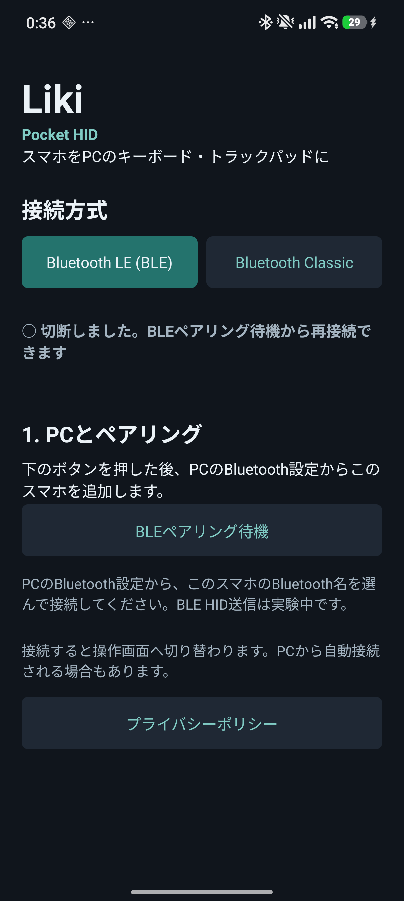

接続画面では上部で方式を選び、下の「BLEペアリング待機」を押します。画像は未接続時の実機画面です。

1. スマホとPCのBluetoothをオンにし、Likiを起動します。
2. Bluetooth接続・公開の権限を許可します。
3. 接続方式で「Bluetooth LE (BLE)」を選び、「BLEペアリング待機」を押します。
4. PCのBluetooth設定でデバイスの追加を開き、スマホのBluetooth名を選びます。
5. 表示されたペアリング要求を確認・承認します。接続後は操作画面へ切り替わります。

BLEではLikiからPCを選んで接続する操作はありません。実装の検証範囲と再接続の既知の問題は[BLE HIDの実装と検証記録](android-ble-hid.md)を参照してください。

### AndroidでClassicを使う

1. Likiを起動し、Bluetoothの権限を許可します。
2. 接続方式で「Bluetooth Classic」を選びます。
3. 「Classicペアリング待機」を押し、PCのBluetooth設定からスマホを追加してペアリング要求を承認します。
4. Likiで「一覧を更新」を押し、ペアリングしたPCを選びます。
5. 「選択したPCに接続」を押します。接続処理をやめる場合は「接続をキャンセル」を押します。

前回の接続先は初期選択されます。アプリが前面から外れるとHID登録が解除される場合があるため、戻った後に接続先を選んで再接続してください。

### iOSで使う

1. 署名済みのLikiを起動します。開発ビルドは先にMetroへ接続します。
2. iPhoneのBluetoothをオンにし、LikiのBluetoothアクセスを許可します。
3. 必要に応じて「BLEペアリング待機」を押します。
4. PCのBluetooth設定から「Liki」を追加し、ペアリング要求を承認します。

iOSではペアリング済みPCの一覧取得や、Liki側からの接続開始はできません。

## 3. メニューを開く

接続後の操作画面で、**右端中央の細い印から左へスワイプ**します。メニューの外側をタップすると閉じます。

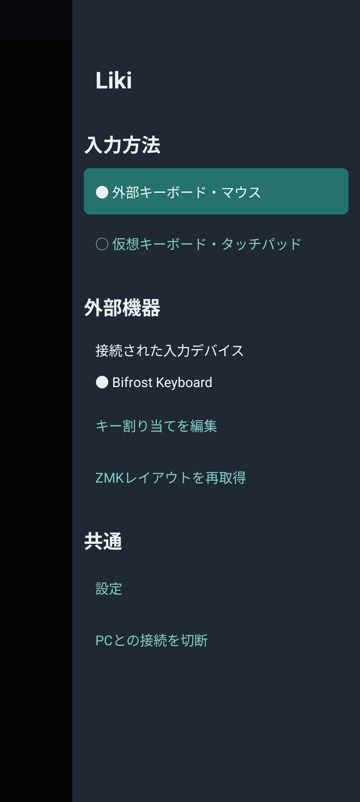

外部キーボード・マウスを選択した状態のメニューです。仮想キーボード・タッチパッドへ切り替えると、レイアウトの選択や保存の項目が表示されます。

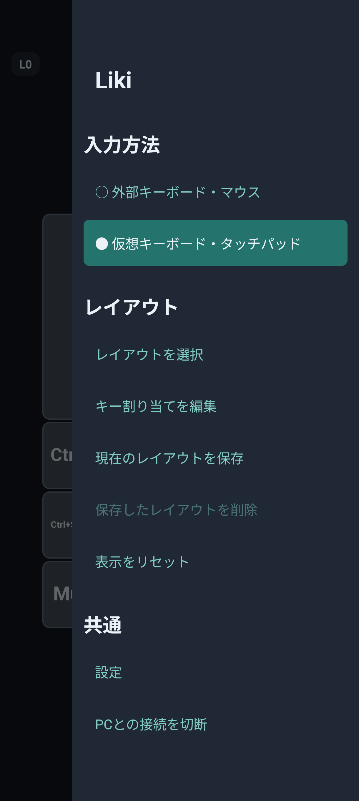

メニューの「入力方法」で「仮想キーボード・タッチパッド」「外部キーボード・マウス」「外部＋仮想キーボード」を選びます。「外部＋仮想キーボード」では中継を続けながら画面の仮想キーも使えます。中継に対応しない接続方式・ビルドでは、外部機器の項目は表示されません。

「設定」で操作感を変更できます。使用を終えるときは「PCとの接続を切断」を押します。BLEで再度接続を待ち受けるときは、接続画面の「BLEペアリング待機」を押してください。

## 4. 画面をキーボードとして使う

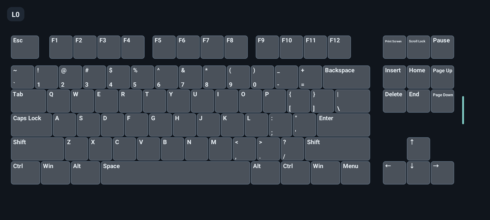

1. メニューの入力方法を「仮想キーボード・タッチパッド」にします。
2. 「レイアウトを選択」→「標準キーボード（TKL）」を選びます。
3. PCでメモ帳などの入力欄を開き、スマホのキーをタップします。

「修飾キーを保持」がオンの場合、Ctrl・Shift・Alt・Win/Cmdをタップすると次の通常キーまで保持します。たとえばCtrlをタップしてからCをタップするとCtrl+Cを送ります。

通常キー上の1本指ドラッグで表示位置を移動し、2本指のピンチで表示倍率を変えられます。それぞれ設定で無効にできます。表示が画面からはみ出したときはメニューの「表示をリセット」を押すと、現在の向きで全体が収まる大きさに戻ります。

PC側のキーボード配列とIMEが入力結果を決めます。自動割り当ては主にUS配列のラベルを基準にするため、PC側が別の配列の場合は記号の入力が異なることがあります。日本語の文字列を直接送信する機能ではありません。

## 5. トラックパッドを使う

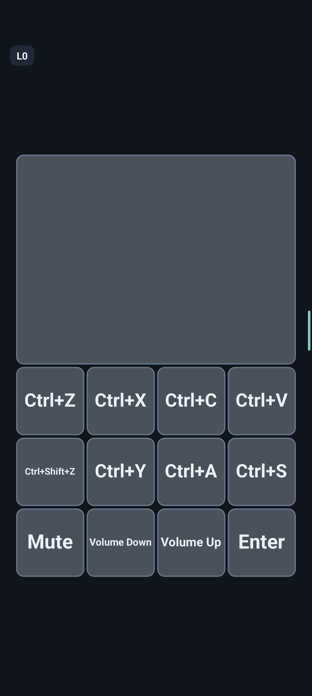

次のどちらかでトラックパッドを表示します。

- メニューの「レイアウトを選択」→「標準トラックパッド」を選ぶ。パッドの下にはコピー・貼り付け、音量などのショートカットキーも表示されます。
- 「設定」→「トラックパッド」→「独立したトラックパッド領域」をオンにする。外部機器の中継中も使用でき、位置は上・下・左・右、大きさは画面の10〜70%から選べます。

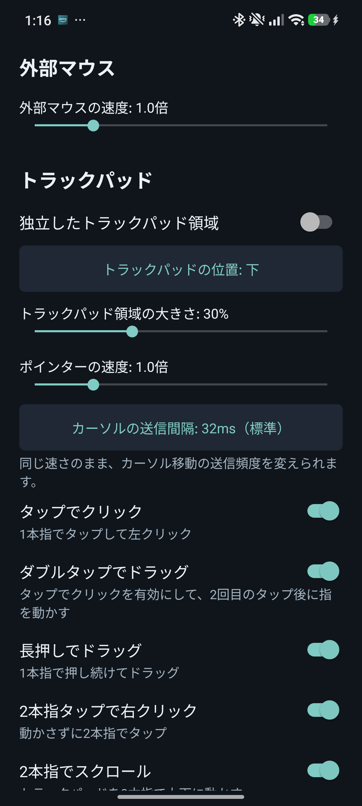

| 指の操作 | PCへ送る操作 |
| --- | --- |
| 1本指を動かす | ポインター移動 |
| 1本指でタップ | 左クリック |
| ダブルタップし、2回目で指を離さず動かす | ドラッグ |
| 1本指で長押しして動かす | ドラッグ |
| 2本指で動かさずタップ | 右クリック |
| 2本指で上下に動かす | 縦スクロール |
| 2本指のピンチ | Ctrl＋ホイールによるズーム |
| 3本指で動かさずタップ | 中クリック |

各ジェスチャーは設定で切り替えられます。ダブルタップのドラッグには「タップでクリック」と「ダブルタップでドラッグ」の両方をオンにします。ピンチズームはCtrl＋ホイールに対応するPCアプリで動きます。

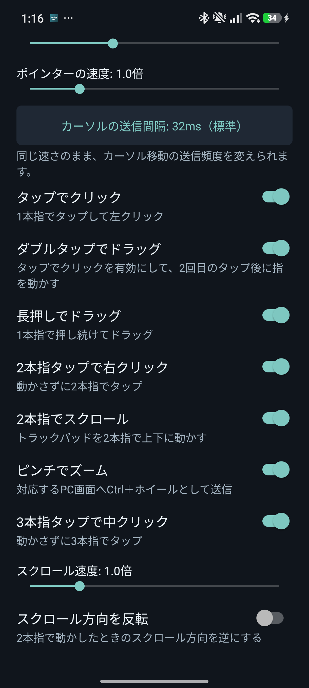

「ポインターの速度」「スクロール速度」は0.5〜3.0倍で調整できます。「スクロール方向を反転」で上下の方向を変えられます。「カーソルの送信間隔」は即時・16ms・32msから選べ、初期値は32msです。これは移動速度ではなく送信頻度の設定です。

## 6. レイアウトを読み込み、保存する

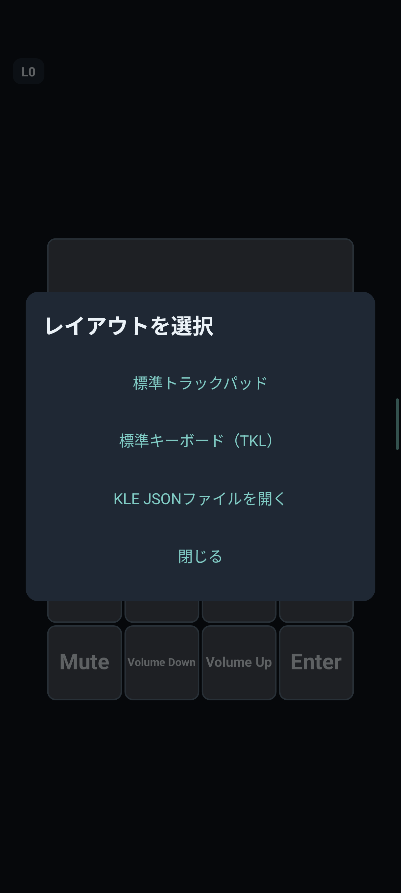

### KLE JSONを読み込む

1. Keyboard Layout Editorで作ったレイアウトを **Download JSON** で保存します。
2. Likiのメニューで「レイアウトを選択」→「KLE JSONファイルを開く」を選びます。
3. 保存したJSONファイルを選びます。

KLEの「Raw Data」をコピーした省略記法は厳密なJSONではないため、Download JSONで取得してください。キーの位置・サイズ・色・回転・ラベルを反映します。`g: true`（Ghosted）の領域はトラックパッドになり、その領域で始めた操作はキーボード表示の移動・拡大縮小には使われません。

### 名前を付けて保存する

メニューの「現在のレイアウトを保存」を押し、1〜40文字の名前を付けます。KLE JSON、全レイヤーのキー割り当て、表示倍率・位置をまとめて保存します。同じ名前を指定すると上書きの確認が出ます。

復元するときは「レイアウトを選択」から「保存: 名前」を選びます。復元後に変更した内容をその名前へ残したい場合は、再度保存してください。「保存したレイアウトを削除」では名前付きの保存データを削除でき、標準レイアウトは削除できません。

標準レイアウトを選び直すと個別のキー割り当ては初期化されるため、残したい配置・割り当ては先に名前を付けて保存します。設定とレイアウトはスマホ内に保存されます。旧Android版・Flutter版の保存内容は引き継ぎません。

## 7. 仮想キーボードのキー割り当てを変更する

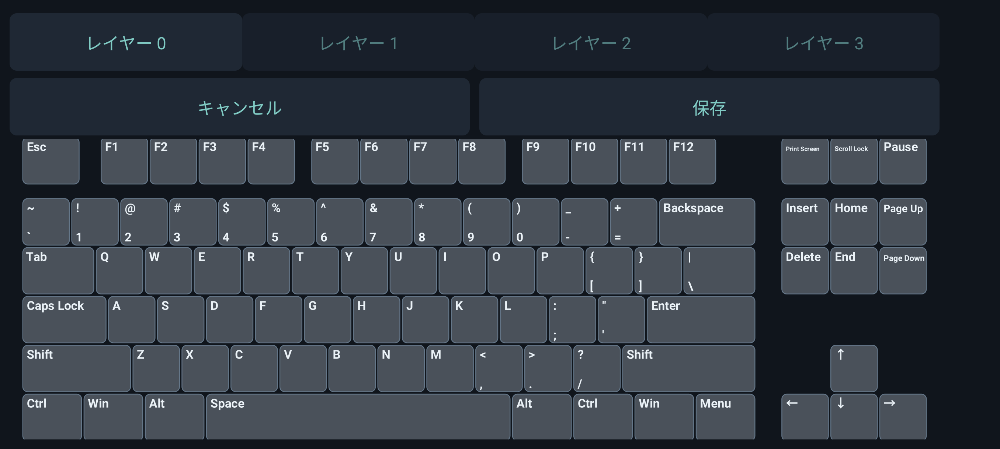

1. メニューの「キー割り当てを編集」を押します。
2. 上部の「レイヤー 0」〜「レイヤー 3」で編集先を選びます。
3. キーをタップし、文字・数字、記号、修飾キー付き、メディアキー、レイヤーなどのカテゴリから割り当てを選びます。
4. 編集画面の「保存」で確定します。「キャンセル」では変更を破棄します。

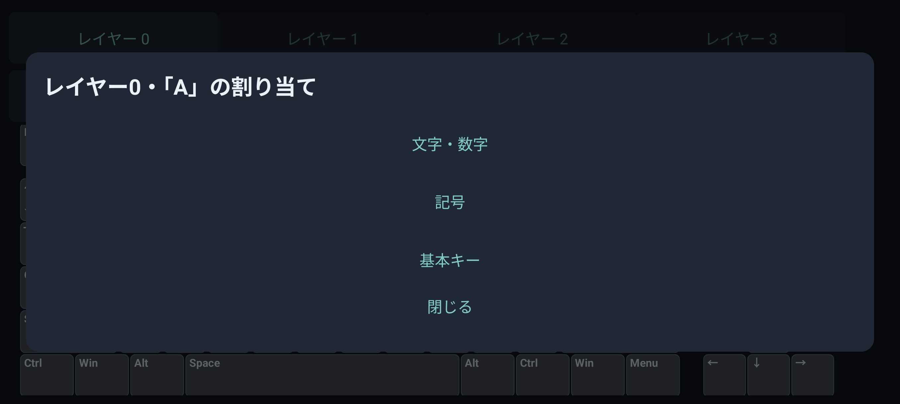

カテゴリ一覧は上下にスクロールできます。画像は一覧上部で、下へ進むと修飾キー付き・メディアキー・レイヤーなどが表示されます。

「修飾キー付き」では修飾キーを選んだ後、通常キーを選びます。修飾キーを追加して複数組み合わせることもできます。ラベルから自動割り当てできないキーは枠が赤く表示されます。レイヤー0の「自動割り当て」でラベルからの推定に戻せます。

レイヤーは同じ配置に別のキー割り当てを持たせる機能です。左上のL0〜L3が現在のレイヤーを表します。レイヤー1〜3で未設定のキーはレイヤー0を継承し、「ベースを継承」で個別の指定を解除できます。

| レイヤーキーの割り当て | 動作 |
| --- | --- |
| レイヤー1/2/3切り替え | 指定先へ切り替え。同じレイヤーでもう一度押すと0へ戻る |
| 次のレイヤー | 0→1→2→3→0の順に切り替え |
| 次の1キーだけレイヤー1/2/3 | 次の通常キーを入力すると元へ戻る。修飾キーだけでは戻らない |
| 押している間レイヤー1/2/3 | 1本の指で押さえ、別の指で入力。離すと元へ戻る |
| レイヤー0へ戻る | 通常の割り当てへ戻る |

## 8. 外部キーボード・マウスを中継する

1. 外部機器をスマホへ接続します。AndroidはBluetoothまたはUSB、iOSはOSが認識するキーボード・マウスが対象です。
2. スマホとPCをBLEで接続します。
3. 右端メニューの入力方法で「外部キーボード・マウス」を選びます。
4. 接続された入力デバイスの表示を確認し、PCの入力欄でキーやマウスを試します。

中継モードの選択は保存され、以前の仮想レイアウトも保持します。戻すときは入力方法を「仮想キーボード・タッチパッド」にします。

「外部＋仮想キーボード」を選ぶと、外部入力の中継と仮想キーボードを同時に使えます。外部のCtrlなどを押しながら仮想キーをタップしても、外部側の押下状態を維持します。このモードではZMK Studioの配列表示の代わりに仮想キーボードを表示します。入力エフェクトは仮想キーやトラックパッドの背景でも使えます。レイアウトの選択・保存と仮想キーの割り当て編集も使えます。編集中は外部入力の中継を一時停止します。

`zmk-feature-liki`の現在レイヤーを受信できている間は、仮想キーボードの表示・割り当ても同じレイヤー番号へ追従し、「ZMK同期」と表示します。同期中のレイヤー切り替えはZMK側で行います。仮想側のレイヤーキーからZMKへ変更を送る機能はありません。未設定の割り当てはベースを継承し、仮想側で個別設定できるのは従来どおりレイヤー0〜3です。通知が取得できなくなると、仮想側でのレイヤー操作が再び使えます。

外部入力中継と独立したトラックパッドを併用した実機画面です。キー入力がない状態では、上部の受信キー表示領域は空になります。

Androidの外部マウスではポインターキャプチャを使うため、Likiのメニューはスマホのタッチで操作します。「設定」の「外部マウスの速度」は0.5〜3.0倍で調整でき、画面のトラックパッドの速度とは別に設定します。中継するマウス操作は相対移動・左/右/中ボタン・ドラッグ・縦ホイールです。

Likiが前面で中継画面を表示している間に入力を扱います。メニュー・設定・ダイアログを開いたときやフォーカス喪失・切断時には押下状態を解放します。OSが予約するキーや、OSから通知されない入力は中継できません。iOSのメディアキー取得は保証しません。

### 一般のキーボードでキーを読み替える

1. 中継モードのメニューから「外部キーボードの割り当てを編集」を開きます。
2. 「入力」でキーを選ぶか、「入力キーを押して検出」を押して実際のキーを押します。
3. 「送信」でPCへ送るキーを選びます。必要なら修飾キーも指定します。「無効化」を選ぶとその入力を送らなくなります。
4. 「登録」を押します。登録済みルールは「変更」「削除」で管理します。

読み替えはスマホ内へ保存され、Likiを経由する入力に適用します。

### 外部キーボードとPCの配列を合わせる

中継モードの右端メニューで「配列変換」を開き、外部キーボードと接続先PCの配列に合わせて「変換なし」「US → JIS」「JIS → US」を選びます。たとえばUSキーボードをJIS配列設定のPCへ中継する場合は「US → JIS」を選びます。個別のキー読み替え後に、記号とShiftの組み合わせを変換します。仮想キーボードには適用しません。

### ZMK Studio対応キーボードを使う

Bluetooth接続したZMK Studio対応機器では、物理配置とレイヤーの割り当てを自動取得します。ロック中はキーボード側でStudioを解除し、メニューの「ZMKレイアウトを再取得」を押します。候補が複数ある場合は対象を1台だけ接続してください。Androidでは入力デバイス名とBluetooth名が一致しない機種を自動取得できません。

設定の「ZMKレイアウトを表示」で配列表示を切り替えます。仮想キーボードが有効な間は仮想キーボードを優先します。「入力エフェクト」は独立して「なし」「マトリックス」「リップル」から選べ、外部キー入力に応じてキーやトラックパッドの背景に表示します。レイヤー通知の受信は継続します。ZMKレイアウト表示にはStudioから取得した配置・割り当てが必要です。

### ZMKの現在レイヤーを連携する

キーボードのファームへ外部モジュール [`zmk-feature-liki`](https://github.com/hringdrifi/zmk-feature-liki) を追加し、`CONFIG_ZMK_LIKI=y` でビルド・書き込みしてください。分割キーボードはcentral側だけに追加します。Android・iPhoneの両方に対応し、独自ネイティブ処理を含むためLikiアプリも再ビルドが必要です。

スマホへBluetooth接続すると、最も優先される有効レイヤーの番号を受信します。上部のレイヤー番号と独立トラックパッドの枠色に反映し、Studioから配列を取得できていればキーボード表示も追従します。Studio未対応・ロック中でもレイヤー番号と枠色は連携できます。枠色は既存のレイヤー0〜3の設定を使い、それより上のレイヤーや未取得時はグレーです。Shift押下中はShift用の枠色を優先します。

接続時には現在値も読み取ります。Liki用サービスを確認できた機器だけ、右端メニューに「ZMKレイヤー連携を再接続」を表示します。同じ機器の通知購読や現在値の取得に失敗してもボタンを残します。現在レイヤーは取得できたときだけ表示し、未取得・エラーの表示は出しません。機器が変わった場合はサービスの確認状態もリセットします。再接続はレイヤー取得用のGATTクライアントを作り直し、通知を購読して現在値を読み直す操作です。候補が複数ある場合は対象を1台だけ接続します。Androidでは入力デバイス名とBluetooth名の一致が必要です。USB接続だけのキーボードは対象外です。

通知モジュールがない場合、表示レイヤーは従来どおり画面上で選択します。受信キーの色付けはキーコードに基づき、物理的な押下位置を確定するものではありません。

取得した配置は1本指のドラッグで移動し、2本指のピンチで拡大縮小できます。設定の「ドラッグでキーボードを移動」「ピンチで拡大縮小」が適用され、「表示をリセット」で全体が収まる表示に戻ります。通常の表示中に画面のキーをタップしてもPCへ入力は送りません。編集画面ではタップで編集するキーを選びます。

割り当てを変更するには「キー割り当てを編集」を開き、レイヤー・配置上のキー・動作とパラメーターを選び、**「キーボードに保存」**を押します。この操作は実際のキーボードへ書き込みます。表示・選択だけでは書き込みません。保存に失敗して未保存表示が出たときは「保存を再試行」または「未保存の変更を破棄」を選びます。

## 9. 表示・操作感を調整する

設定の変更はすぐに端末内へ保存されます。

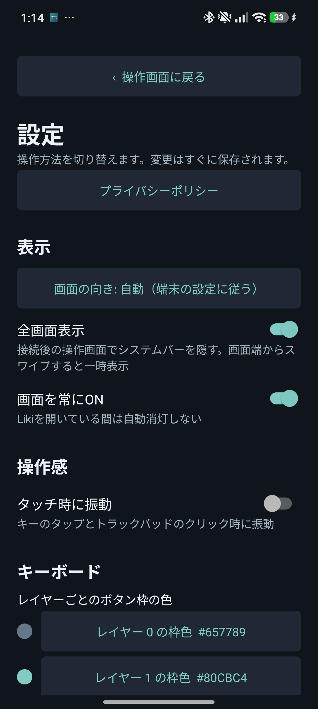

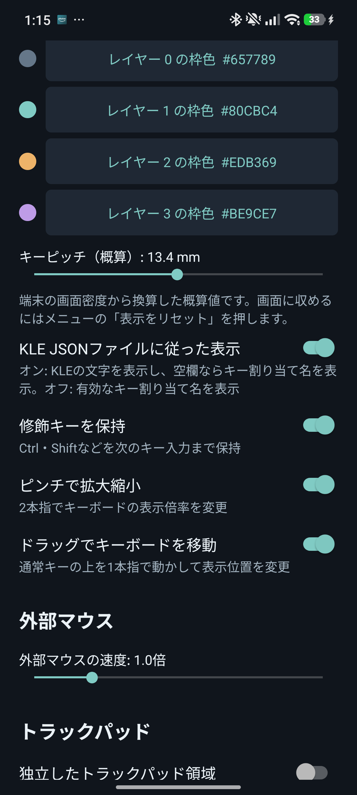

| 設定 | 用途 |
| --- | --- |
| 画面の向き | 自動・縦・横・横の反対向きを選ぶ |
| 全画面表示 | 操作画面のシステムバーを隠す。画面端からのスワイプで一時表示 |
| 画面を常にON | Likiを開いている間の自動消灯を防ぐ |
| ZMKレイアウトを表示 | Studioから取得した配列を表示。仮想キーボードが有効な間は仮想側を優先 |
| 入力エフェクト | 外部キー入力の背景演出。なし・マトリックス・リップルから選ぶ |
| タッチ時に振動 | キーやトラックパッドのクリック時に振動。初期状態はオフ |
| 振動の強さ | 弱・標準・強の3段階。初期状態は標準。端末によって強度の差は異なる |
| レイヤーごとの枠色 | 色候補または`#RRGGBB`で指定 |
| キーピッチ（概算） | キーの大きさを3.0〜24.0mmで調整。画面密度に基づく概算値 |
| KLE JSONファイルに従った表示 | オンならKLEラベル（空欄なら割り当て名）、オフなら有効な割り当て名を表示 |

## 困ったとき

| 症状 | 確認すること |
| --- | --- |
| アプリの画面を読み込めない | 開発ビルドではMetroへの接続を確認。[導入手順](build-and-install.md)を参照 |
| PCにスマホが出てこない | Bluetooth・Likiの権限・ペアリング待機を確認。BLEでは端末のPeripheral対応も必要 |
| Classicで「HIDサービスを準備中…」から進まない | OSがHID Deviceサービスを提供しているか確認。未対応端末ではClassicを使用できない |
| Android BLEでアプリ再起動後に再接続できない | 既知の未解決問題あり。[再接続の検証記録](android-ble-hid.md)と任意の[Windows再接続サポート](../tools/windows-reconnect/README.md)を参照 |
| キーボードが画面外にある | 右端メニューの「表示をリセット」 |
| 記号が違う | PC側のキーボード配列とIMEを確認 |
| メディアキーが認識されない | 古いHID情報が残っている可能性あり。再ペアリングを行うと双方の登録をやり直す必要がある |
| ZMKレイアウトが取得できない | Studioロック、接続台数、Androidでは機器名の一致を確認して再取得 |
| iOSでトラックボール入力が届かない | Bifrostのトラックボール入力は調査中。文字キー中継の確認とは別の未解決項目 |

AndroidのBLE入力とキーボード・マウス中継、iOSのBifrost配置取得と文字キー中継は既存の実機確認記録があります。iOSのマウス入力はビルド成功と実機動作を区別し、接続した機器ごとに確認してください。
